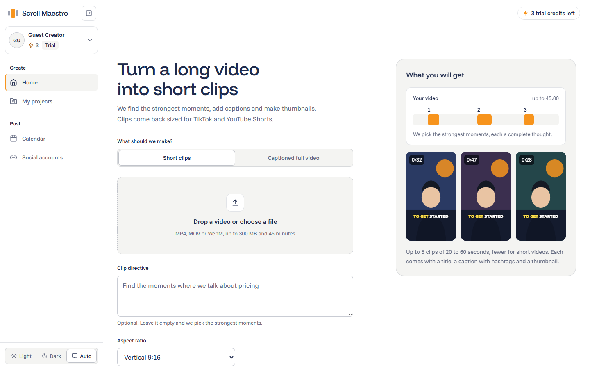
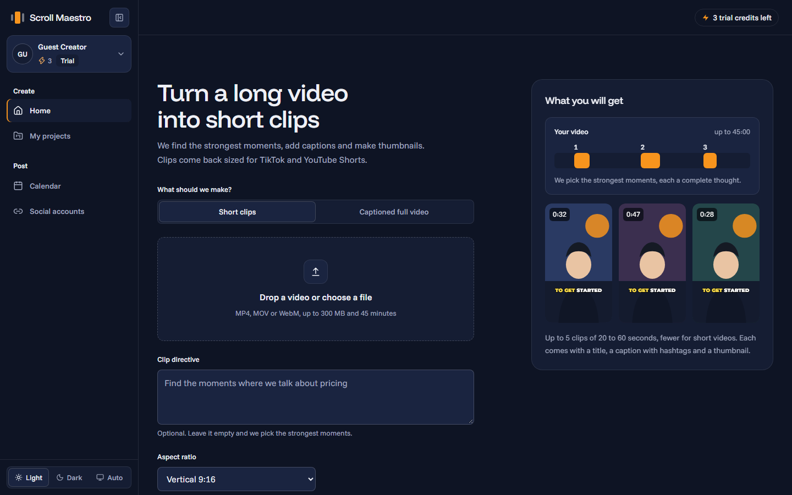
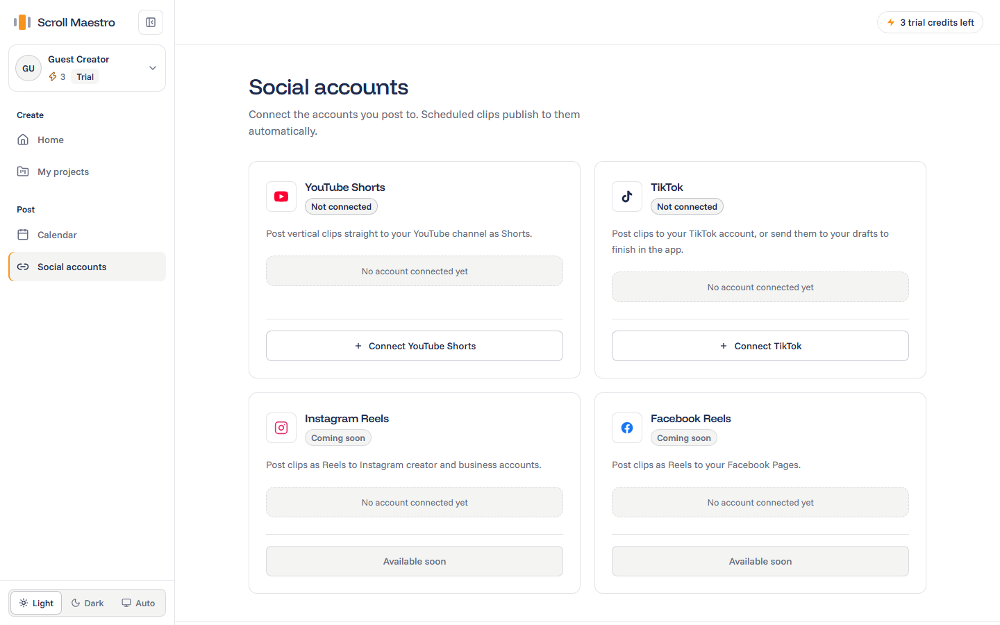
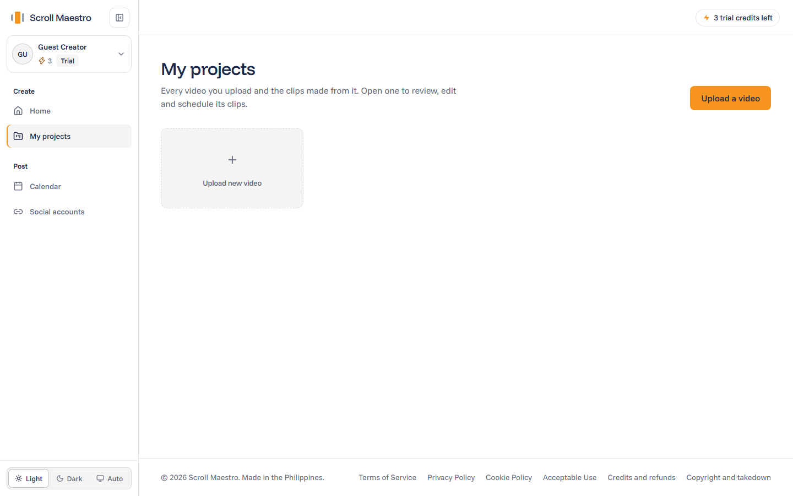
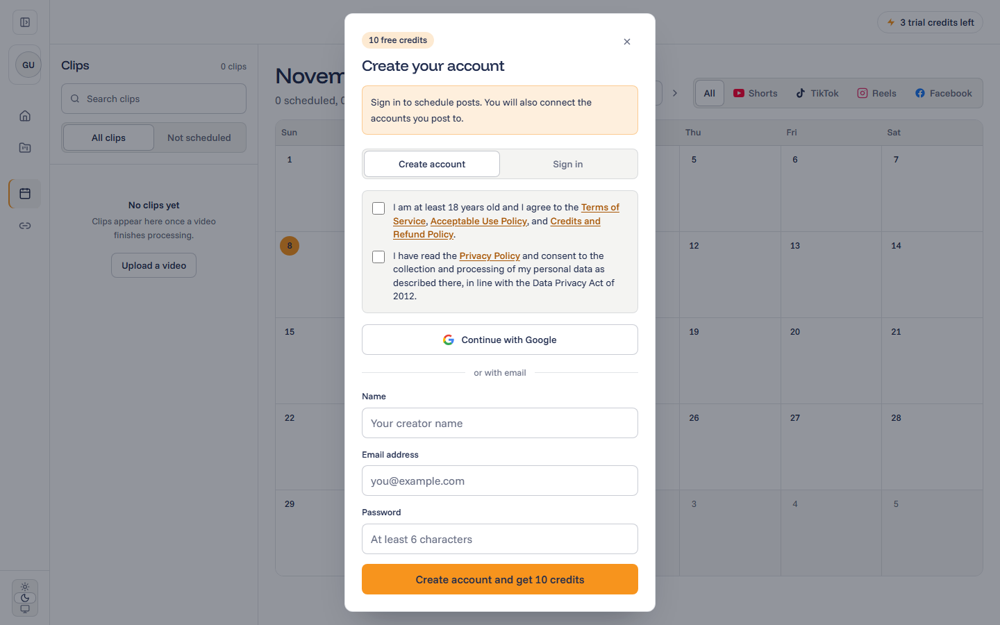
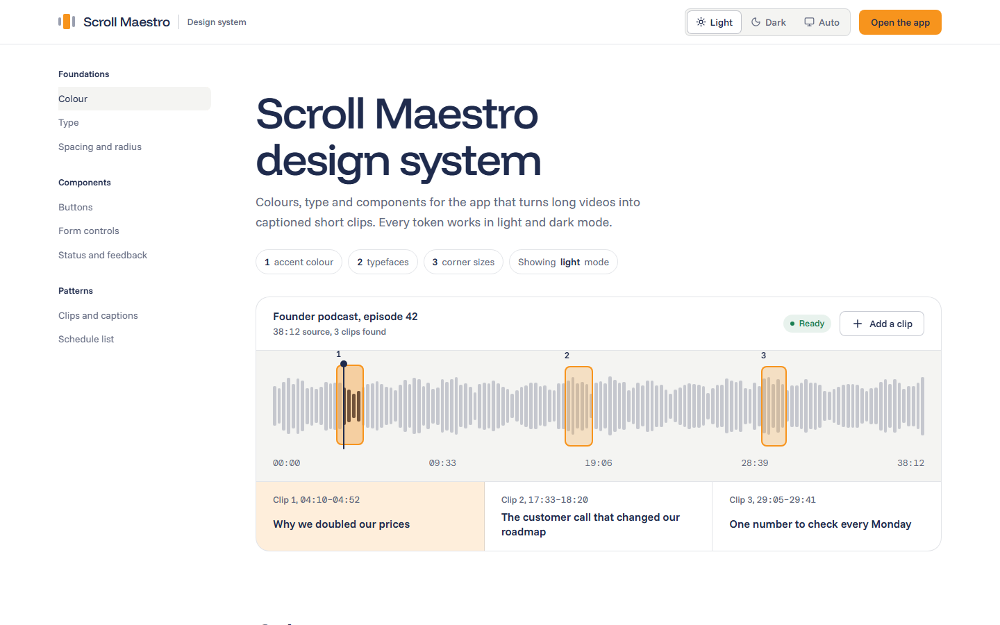
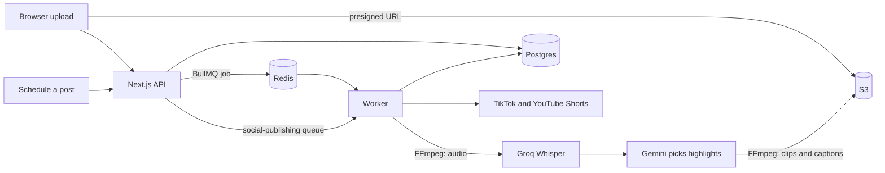

# Scroll Maestro

Turn a long video into short, captioned clips and post them to TikTok and YouTube Shorts.

Upload a video (up to 300 MB and 45 minutes). Scroll Maestro transcribes it, picks the strongest moments, cuts vertical clips with burned-in captions and thumbnails, and lets you schedule them to your connected accounts.

| Light | Dark |
|---|---|
|  |  |

## Features

- **Short clips or a captioned full video.** Let the AI choose up to five clips per video, steer it with a plain-language directive ("find the moments where we talk about pricing"), or caption the whole video.
- **Eight caption styles, or none.** Karaoke, Highlight, Minimal, Pop, Marker, Box, Neon, and Headline, with a hover-to-play preview.
- **Vertical, square, or landscape output**, loudness-normalised and sized for TikTok and YouTube Shorts.
- **Scheduling calendar.** Drag clips onto days, pick a time, and post to several accounts at once.
- **Direct publishing.** TikTok (Direct Post or Drafts) and YouTube Shorts through OAuth, with automatic token refresh. If a connection is revoked, the account is flagged for reconnection and the failed posts are retried automatically once you reconnect.
- **Credits.** New accounts get free credits. Failed processing is refunded automatically.
- **Guest trial.** Try it without signing up; guest work merges into your account when you register.
- **Light, dark, and auto themes** across every page. The design system lives at `/designsystem`.
- **Philippine legal pages** (Privacy Policy under the Data Privacy Act, Terms, Cookies, Acceptable Use, Refunds, Copyright) with consent recorded at sign-up.

## Screenshots

| | |
|---|---|
|  |  |
| **Social accounts**: connect YouTube Shorts and TikTok. | **My projects**: every upload and the clips made from it. |
|  |  |
| **Sign-up** with explicit Terms and Privacy consent. | **Design system** at `/designsystem`. |

## How it works



1. The browser uploads straight to S3 through a presigned URL. The web app checks the size and duration limits first.
2. Next.js enqueues a BullMQ job. Progress reaches the UI through Postgres, not Redis.
3. The worker extracts mono 16 kHz audio with FFmpeg and sends it to Groq Whisper (`whisper-large-v3-turbo`) for a word-timed transcript.
4. Gemini chooses highlights as sentence ranges. Pure functions in `clipSelection.ts` snap them to word boundaries and enforce 8 to 90 second clips. If Gemini fails three times, a deterministic transcript-based fallback takes over.
5. FFmpeg renders each clip with burned-in captions (libass) and a thumbnail, and uploads them to S3.
6. Scheduled posts go through a separate `social-publishing` queue to TikTok and YouTube.

## Tech stack

| Area | Tools |
|---|---|
| Web | Next.js 16 (App Router), React 19, Tailwind v4, NextAuth v5, Zod v4 |
| Worker | Node (ESM) and TypeScript, BullMQ and ioredis, FFmpeg, Vercel AI SDK with Gemini |
| Data | PostgreSQL through Prisma 7, Redis (Upstash in production) |
| Storage | AWS S3 |
| AI | Groq Whisper for transcription, Google Gemini for highlight selection |
| Hosting | Vercel (web), Render (worker, Docker) |

## Repository layout

```
apps/web          Next.js app (UI and API route handlers)
apps/worker       BullMQ worker: transcription, clip selection, rendering, publishing
packages/database Prisma schema and migrations, video lifecycle and upload-limit helpers
Dockerfile.worker Worker image with FFmpeg and caption fonts
```

`apps/transcriber` is a deprecated Flask service and is not used.

## Getting started

### Requirements

- Node.js 20 or later
- Docker (for local Postgres and Redis)
- FFmpeg (the Docker image has it; install it locally to run the worker outside Docker)
- Accounts and keys for AWS S3, Groq, and Google Gemini. YouTube and TikTok OAuth apps are only needed to test publishing.

### Setup

```bash
# 1. Install from the repository root (never inside a sub-package)
npm install

# 2. Start Postgres 16 and Redis 7
docker compose up -d
```

Create `packages/database/.env`, `apps/web/.env`, and `apps/worker/.env` (see the table below), then:

```bash
# 3. Create the database tables (run in packages/database)
npx prisma migrate deploy
npx prisma generate
```

```bash
# 4. Run the web app and the worker (two terminals, from the root)
npm run dev:web
npm run dev:worker
```

The web app runs on <http://localhost:3000>. Set `SOCIAL_PUBLISH_DRY_RUN=true` on the worker to simulate publishing without real accounts.

### Environment variables

Never commit `.env` files.

| Variable | Web | Worker | Notes |
|---|:-:|:-:|---|
| `DATABASE_URL` | ✓ | ✓ | Postgres connection string. Required. |
| `DIRECT_URL` | | | Direct (non-pooled) connection used for migrations. |
| `REDIS_URL` | ✓ | ✓ | `redis://localhost:6379` locally. |
| `AWS_REGION`, `S3_BUCKET_NAME`, AWS credentials | ✓ | ✓ | Video, clip, and thumbnail storage. |
| `GROQ_API_KEY` | | ✓ | Transcription. |
| `GOOGLE_GENERATIVE_AI_API_KEY` | | ✓ | Gemini highlight selection. |
| `GOOGLE_CLIENT_ID`, `GOOGLE_CLIENT_SECRET` | ✓ | ✓ | Google sign-in and YouTube OAuth. |
| `TIKTOK_CLIENT_KEY`, `TIKTOK_CLIENT_SECRET` | ✓ | ✓ | TikTok OAuth and token refresh. |
| `AUTH_SECRET` | ✓ | | NextAuth secret. |
| `NEXT_PUBLIC_APP_URL` | ✓ | | Base URL for OAuth redirect URIs. |
| `WORKER_PUBLIC_URL` | ✓ | ✓ | Used to wake and keep alive the Render worker. |
| `PORT`, `FFMPEG_PATH`, `SOCIAL_PUBLISH_DRY_RUN` | | ✓ | Optional. |

### Checks

There is no test suite. Before opening a pull request, run:

```bash
npx tsc --noEmit -p apps/worker
cd apps/web && npx tsc --noEmit && npm run lint
```

## Deployment

- **Web** deploys to Vercel from this repository.
- **Worker** deploys to a Render web service from `Dockerfile.worker`. It starts with `node --expose-gc --max-old-space-size=220` to fit the free tier, and serves `/health` so Render keeps it alive while jobs are queued. A free instance sleeps after 15 minutes of no traffic; the web app wakes it when it enqueues work.
- **Redis quota.** Upstash's free tier allows 500k commands a month, so the worker polls slowly on purpose. Read the Redis section of [AGENTS.md](AGENTS.md) before changing worker options.

## Contributing

Conventions, invariants, and the rules for queues, credits, and the video lifecycle are in [AGENTS.md](AGENTS.md). Read it before making changes.

## Legal

Replace the placeholder business details in `apps/web/src/lib/legal.ts` before launch, and have a Philippine lawyer review the policies.

## License

ISC
